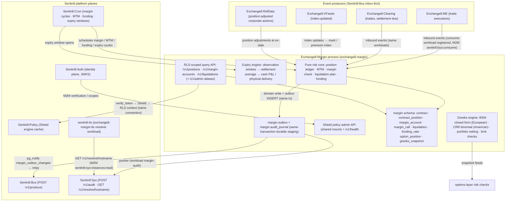

# Exchange8:Margin

## 1. Summary

Exchange8:Margin is the asynchronous, stateful derivatives-risk engine of the
exchange8 vertical (the capital-markets tier of the Sentin8 platform). It owns
the net-position ledger per (environment, account, contract) for futures,
perpetuals, and options; revalues that ledger against mark/index prices
(mark-to-market); computes initial and maintenance margin and decides
liquidations; applies perpetual funding; prices options with the
Black-Scholes-Merton closed form (European) and the Cox-Ross-Rubinstein
binomial tree (American, early exercise); and runs the futures/expiry
settlement state machine (`open → expiring → settled`, cash or physical).

The risk core is a set of pure Rust modules (`services/margin/src/margin.rs`,
`greeks.rs`, `expiry.rs`): value types and pure functions with no clock, no
tokio, and no database dependency. The service binary wraps them in the
Sentin8 platform shell (`sentin8::shell`): axum HTTP/ TLS surface,
`--print-registration` self-registration, DB pool, health endpoint, Shield
The HTTP data surface is the RLS-scoped query API for positions, margin
accounts, and liquidations plus RFW admin aliases; cycle scheduling (margin
cycles, MTM runs, funding, expiry) is delegated to Sentin8:Cron. Durable event
delivery rides the platform planes: the local `margin.outbox` relays to
Sentin8:Bus and `margin.audit_journal` pushes to Sentin8:Sys.

## 2. Motivation

- **Different latency profile, different failure model than pre-trade risk.**
  Exchange8:Risk is a stateless microsecond pure-function gate; margin, by contrast,
  must maintain positions over time, revalue them continuously, close
  breached positions, and never lose a funding or liquidation decision. Merging
  the two would force one latency budget on two incompatible workloads - the
  platform therefore splits them (margin design §1).
- **Defensible account risk under audit.** Average-entry position math,
  realized/unrealized P&L, maintenance-requirement checks and shortfall
  quantification must be provable, table-tested pure functions. A margin check
  that cannot be replayed bit-exactly is a dispute waiting to happen.
- **Options are Greeks-shaped, not notional-shaped.** Option risk limits act
  on delta-equivalent notional, gamma, and vega exposure - a different
  dimension than notional-based pre-trade checks, computed from one shared
  Greeks shape so portfolio netting stays exact.
- **Expiry must be exact and idempotent.** A contract settles once, at one
  settlement price (the observation-window average), with cash P&L or physical
  delivery obligations; a crashed settle must replay to the identical result.
- **No bespoke infrastructure.** Identity, TLS, policy administration, event
  durability, audit delivery, and scheduling are all platform services
  (Sentin8:Auth, `sentin8-tls`, Shield, Sentin8:Bus, Sentin8:Sys,
  Sentin8:Cron); the binary only owns the derivatives-risk domain.

## 3. Architecture & High-Level Design

The engine is **event-driven and stateful**; the HTTP surface is query-only
(RLS-scoped views over the margin ledger). Position accounting, margin, MTM,
liquidation, funding, Greeks, and expiry are pure modules; the shell owns
registration, the database pool, health, the Shield admin API, the outbox
relay, and the audit pusher.

The shell (`main.rs`) boots the DB pool (`EXCHANGE8_MARGIN_DATABASE_URL`), the
Shield boot load (fail-closed on unparsable policy text), the query router,
the shared policy-admin mount, the `margin.outbox` relay, and the
`margin.audit_journal` pusher. The risk modules - `margin.rs` (position
ledger, margin checks, funding, liquidation), `greeks.rs` (BSM Greeks +
portfolio netting + limits), `expiry.rs` (CRR binomial + expiry/settlement
state machine) - are free of tokio, DB, and clock dependencies, which is what
makes unit testing and idempotent expiry exact.

## 4. Key Traits and Data Structures

Concept and data-structure overview (the authoritative shapes live in the
source modules); signatures are illustrative, not API dumps.

- **Position ledger (`Position`)** - signed net quantity, volume-weighted
  average entry, and accumulated realized P&L in raw fixed-point units.
  `apply_fill` handles the three fill cases: *addition* (weighted average in
  absolute-quantity space), *reduction* (realizes P&L against the average,
  keeps it), and *flip* (realizes the whole old position, rebuilds the average
  from the new price). A close to flat resets the entry and keeps the realized
  P&L.
- **Margin account (`MarginState`)** - posted equity plus the per-account
  maintenance and initial margin basis points. Requirement is
  `|qty| × mark × bps/10⁴`; effective equity is `equity + unrealized(mark)`
  (cash-settled variation); the check yields either *Ok* or *Liquidate* with
  the quantified shortfall.
- **Funding (`funding_payment`)** - pure perpetuals funding:
  `clamp(premium_index, ±cap) × qty × mark / 10⁴`, sign flowing through the
  signed quantity - longs pay when the premium index is positive, shorts
  receive, and the sign flips below zero.
- **Liquidation plan (`Liquidation`, `evaluate_liquidation`)** - for a
  breached non-flat account: close quantity `|qty|`, close side opposite the
  position (a long is closed by selling, a short by buying), the shortfall,
  and the mark the check ran against. The plan is the input to the market
  close order destined for Exchange8:ME.
- **Greeks engine (`GreeksInput`, `Greeks`)** - Black-Scholes-Merton closed
  form for European calls/puts: theoretical price plus delta, gamma, vega,
  theta, rho per unit of underlying. Degenerate inputs (non-positive spot,
  strike, vol, tau) are rejected, never defaulted. The normal CDF is an
  erf-based rational approximation (Abramowitz-Stegun), with the √2 argument
  conversion handled explicitly.
- **Portfolio netting (`GreeksLeg`, `PortfolioGreeks`, `aggregate_greeks`)** -
  portfolio-level Greeks: underlying legs contribute `±qty` delta; option legs
  contribute `qty × multiplier × per-unit Greek`. Netting is per account, not
  per leg.
- **Options risk check (`GreeksLimits`, `check_greeks`)** - delta-equivalent
  notional (`delta × underlying price`), gamma, and vega exposure limits per
  account, evaluated on absolute values so short books trip the same limits.
- **CRR binomial (`BinomialParams`, `crr_price_american`)** -
  Cox-Ross-Rubinstein backward induction with early exercise
  (`max(intrinsic, continuation)` at every node); the American-exercise premium
  path the BSM closed form cannot price. Greeks come from finite differences
  of the tree and reuse the same `Greeks` shape as the closed form.
- **Expiry engine (`ExpiryEngine`, `ExpiryState`, `ContractSettlement`)** -
  the futures/expiry lifecycle: `enter_expiry` opens the window
  (`expiring`), `observe` accrues settlement-price observations, and `settle`
  computes the arithmetic-mean settlement price, then either cash P&L per
  account or physical delivery obligations (long receives, short delivers).
  `settle` is idempotent (a repeated call returns the recorded settlement) and
  refuses to run without observations.

## 5. Rationale, Trade-offs, and Alternatives

- **Pattern choices.**
  - *Pure core + thin shell.* All risk math lives in pure value types; the
    shell owns I/O, identity, persistence, and scheduling delegation. Risk
    formulas are the auditable surface of the venue - embedding them in
    request handlers or DB tasks would make them untestable and un-replayable.
  - *Outbox-first events.* Margin decisions (calls, liquidations, funding) are
    staged in `margin.outbox` in the same transaction as the domain write and
    relayed idempotently to Sentin8:Bus (idempotency key = outbox row id), so
    a Bus outage delays but never drops or duplicates a risk event.
  - *Fixed-point integrity.* Prices, quantities, P&L, and notional stay in
    raw fixed-point (`i128`/`NUMERIC`) in the engine and the schema;
    floating point is confined to the Greeks module's transcendental math,
    where it is reported per unit, never stored as money.
- **Dispatching.** Option pricing splits by nature, not by strategy object:
  European contracts use the BSM closed form, American exercise uses the CRR
  tree - a closed enum over a closed set of models. Dynamic dispatch would
  put a vtable between the risk cycle and its pricing for no extensibility
  benefit, while the enum keeps each pricer pure and property-testable
  (parity, convergence, exercise-bound).
- **Concurrency.** The service is deliberately mostly stateless: axum
  request tasks serve the RLS-scoped query surface, and the durable workers
  (outbox relay, audit pusher, policy hot-reload consumer, stat emitter) are
  shell-owned tokio tasks. Cycle scheduling lives in Sentin8:Cron rather than
  an in-process loop - one scheduler for the whole platform, no per-instance
  duplication across replicas, and retries survive instance drain.
- **Rejected alternatives.**
  - *In-process scheduler*: a second scheduling engine would double-fire
    cycles across replicas and fight the captain's registry; Sentin8:Cron owns
    scheduling by platform rule.
  - *Event-sourced rebuild as the only position state*: the margin design
    reconciles the event-sourced position ledger against the trade stream, but
    the durable table (`margin.contract_position`) is the serving state -
    rebuilding a live book from the trade stream on every start would couple
    margin availability to replay latency.
  - *Float pricing in the margin engine*: basis-point fractions fit fixed
    integer math (`value × bps / 10⁴`) with exact reproducibility; floats
    would make margin checks non-deterministic across platforms.
  - *SPAN/portfolio libraries today*: the contract master declares all four
    margin models, but the shipped engine computes the bps-based (isolated/
    cross) requirement; a SPAN implementation is a future design decision,
    not an embedded dependency.

## 6. Internal Implementation & Invariants (Private Design)

- **Position fill math.** Addition weights the entry in absolute-quantity
  space so the sign never cancels:
  `avg' = (avg×|old| + px×|add|)/(|old|+|add|)`. A reduction realizes
  `per_unit × close_abs × qty.signum()` (the sign makes the same formula
  cover short covers), keeps the average, and resets it only at flat. A flip
  realizes the whole old position once, then rebuilds `avg_entry` from the
  crossing price.
- **Margin check order.** Requirement is computed from `|qty| × mark × bps`,
  then compared to effective equity (posted equity + unrealized variation).
  The check outcome carries the requirement, and on breach the shortfall -
  the liquidation engine prices the close from the plan, not from a re-derivation.
- **Funding sign convention.** `funding_payment` returns the amount *charged
  to the account*: a long (positive qty) with a positive clamped premium pays
  (negative result); a short receives. The table `margin.funding_rate` keeps
  premium index, cap, and clamp-applied `rate_bps` so every applied rate is
  reproducible.
- **Liquidation side.** `close_is_buy` is true exactly when the position is
  short; the plan's `close_qty` is the absolute position. Idempotency for the
  liquidation engine rides `margin.liquidation` rows; the `state` check permits
  `pending/submitted/filled/failed` for the submit → fill cycle of the close
  order.
- **Greeks numerical hygiene.** The `erf` rational approximation (A&S 7.1.26)
  carries a residual of about `1e-9` at zero - tests assert against reference
  values at that tolerance, and the CDF argument is scaled by
  `FRAC_1_SQRT_2` (multiplying by the constant, then by nothing else - the
  inverted conversion is a documented bug class). Put-call parity and
  delta parity are asserted exactly in tests; gamma/vega equality across
  calls and pins the closed form.
- **CRR tree.** `u = e^{σ√dt}`, `d = 1/u`, risk-neutral probability clamped
  to `[0,1]`; terminal payoffs then backward induction with early exercise at
  every node; finite differences use `0.1%` spot bump, `1/100` of tau,
  `1e-4` sigma and rate bumps. The European case converges to the BSM closed
  form within tree tolerance, which is asserted.
- **Expiry settlement.** The settlement price is the arithmetic mean of
  observation-window ticks; cash settlement books `qty × (settlement − entry)`
  per account; physical settlement records signed delivery obligations (long
  receives, short delivers). On settle, the contract terminalizes to
  `Settled`, the position snapshot is dropped, and a second settle returns the
  recorded result (idempotent; unknown contract or empty window → `None`).
- **RLS posture.** Every tenant table (`margin.*`) carries
  `ENABLE` + `FORCE ROW LEVEL SECURITY` with
  `sentin8_context_initialized() AND env_id = sentin8_current_env_id()`
  policies; handlers set the context on the same transaction that queries
  (`SELECT sentin8_set_tenant_context($1)`, always awaited) and add explicit
  `WHERE env_id = $1` clauses as defense-in-depth.
- **Invariants always true:** P&L realization is conserved (Σ realized from
  reductions equals the flip/realization math; no drift); requirement scales
  monotonically in `|qty|`, mark, and bps; funding never exceeds the clamp;
  a flat account can never be in a liquidation plan; `settle` is idempotent
  per contract; every durable table is RLS-forced and only reachable through
  a set tenant context; the Shield scope-mirror set covers every action the
  handlers evaluate (wired by tests, no-set/no-match → deny).

## 7. Unresolved Questions / Future Designs

- **Outbound event envelopes.** The exact `exchange8:margin:{resource}:{operation}`
  event strings and payload mapping for calls, liquidations, funding, and
  position updates on `margin.outbox` are the open writer surface (the schema,
  relay, and workloads are declared; the writers ride with the cycle
  wiring).
- **Inbound consumption wiring.** Trade/index/settlement/corporate-action
  consumption workloads are registered (`sentin8:bus:consume`) but the
  concrete consumer task topology and consumer groups are open.
- **Liquidation close-order submission.** The close plan is computed and the
  `margin.liquidation` state machine declared; the market-order submission to
  Exchange8:ME, retry/escalation, and the `failed` escalation path are open.
- **SPAN / portfolio margin.** The `margin_model` column declares four
  models; the engine implements the bps-based (isolated/cross) requirement -
  SPAN and portfolio margin are design-level open questions.
- **Index-source binding.** Which `margin.contract` index feed drives funding
  and expiry settlement (constituents, outlier rejection, staleness guards)
  is owned by Exchange8:VFeeds and not yet bound here.
- **Funding posting rails.** Funding is a posting, not a trade; the fiat
  (Bank8:Ledger) / custody (crypto) rail integration for moving value
  between longs and shorts is open.
- **Greeks snapshot writers.** `margin.greeks_snapshot` is a declared cache
  for the options-layer risk checks and the dashboard; the writer cadence
  (per tick / per cycle) and the implied-vol surface feed are open.
- **RFW admin page mounts.** The declared pages
  (`/v1/admin/ui/positions|accounts|liquidations`) are registered at
  enrollment; the `GET /v1/admin/ui/...` page mounts and the accounts data
  endpoint naming (`/v1/admin/accounts` vs the mounted
  `/v1/admin/margin-accounts`) are open.
- **Physical-delivery workflow.** The expiry engine records delivery
  obligations; the custody/CCP handoff downstream belongs to Exchange8:Settlement
  and is not wired here.
- **Margin-call lifecycle.** `margin.margin_call` is an append-only event
  table; a margin-call lifecycle (acknowledgment, expiry, escalation rules)
  is an exchange-policy decision pending product rules.

---

**Architecture & Design:** exchange8:margin and its underlying concepts were designed by [Hamid Jahanzad](https://www.linkedin.com/in/hamidjahanzad/).
